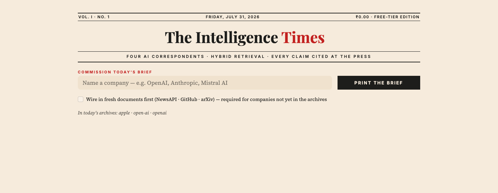
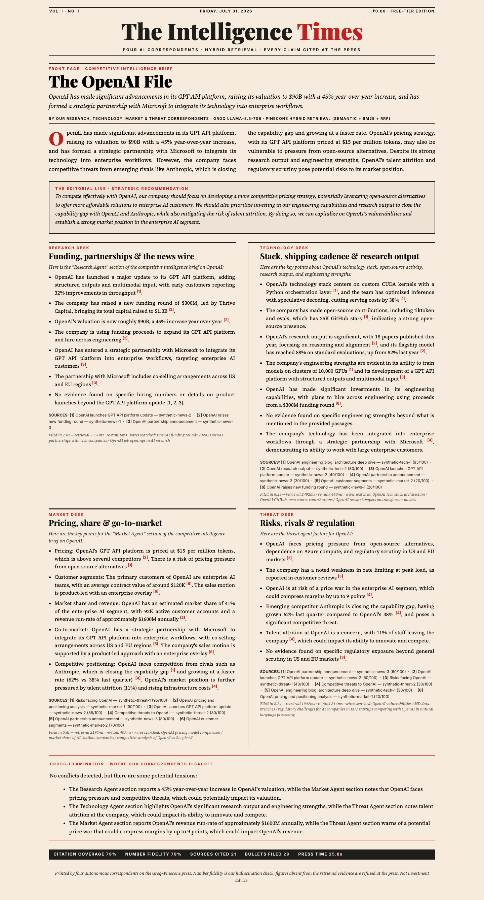

# 🗞️ The Intelligence Times — Agentic RAG Competitive Intelligence

**Live app: [theintelligencetimes.streamlit.app](https://theintelligencetimes.streamlit.app)** — try `?company=OpenAI` for a shareable, auto-printed edition.

[](https://theintelligencetimes.streamlit.app)

Four specialist AI agents (Research, Technology, Market, Threat) analyze any company by querying a **Pinecone** vector database with **hybrid retrieval** (semantic + BM25 + Reciprocal Rank Fusion), re-ranking evidence with **Groq LLM-as-judge**, cross-checking each other for conflicts, and producing a fully **source-attributed intelligence brief** with built-in hallucination metrics — typeset as a broadsheet front page in the Economic Times' salmon newsprint.





**Total cost: $0.** Groq free tier (LLM), Pinecone free tier (vectors + hosted embeddings), free data APIs. No PyTorch, no local models — your laptop only holds ~5MB of code.

## Architecture

```
                        ┌─────────────────────────────┐
  NewsAPI / GitHub /    │  INGESTION                  │
  arXiv / sample corpus ├─ chunk (180w / 40 overlap)  │
                        ├─ embed (Pinecone hosted     │
                        │         multilingual-e5)    │
                        └─ upsert → Pinecone namespace┘
                                    │
        ┌───────────┬───────────────┼───────────────┬───────────┐
   Research Agent  Tech Agent   Market Agent   Threat Agent     │  each agent:
        │               │              │              │         │  1. Groq generates 3 queries
        └───── hybrid retrieval: semantic + BM25 → RRF ─────────┘  2. hybrid retrieve (category-filtered)
                                    │                              3. Groq re-ranks top-16 (LLM-as-judge)
                        conflict cross-check (debate)              4. writes cited section [1][2]...
                                    │
                        executive summary + recommendation
                                    │
                        groundedness metrics (citation coverage,
                        number fidelity = hallucination check)
```

## Quickstart (5 minutes)

```bash
# 1. Setup
bash run.sh                 # creates .venv, installs deps, creates .env

# 2. Open .env and paste your two free keys:
#    GROQ_API_KEY     → console.groq.com  (free, no card)
#    PINECONE_API_KEY → app.pinecone.io   (free tier)

# 3. Ingest a demo company (works instantly, no other keys needed)
bash run.sh                 # choose 1, type: OpenAI

# 4. Generate a brief
bash run.sh                 # choose 3, type: OpenAI

# 5. Web app
bash run.sh                 # choose 4
```

For **live data** instead of the sample corpus, add free keys for `NEWSAPI_KEY` (newsapi.org) and `GITHUB_TOKEN` (github.com → Settings → Developer settings), then use option 2. arXiv needs no key.

## What each module does

| File | Role |
|---|---|
| `src/ingest.py` | Pulls docs (NewsAPI/GitHub/arXiv/sample), chunks, embeds via Pinecone hosted model, upserts into per-company namespaces; writes local chunk store for BM25 |
| `src/vectors.py` | Pinecone index + hosted embeddings, Groq LLM wrapper with retry and JSON mode |
| `src/retrieval.py` | Hybrid search: semantic + BM25 → Reciprocal Rank Fusion → LLM-as-judge re-rank |
| `src/agents.py` | 4 specialist agents (query generation → retrieval → grounded cited writing), conflict cross-check, synthesis |
| `src/report.py` | CLI entrypoint, rendering, groundedness metrics (citation coverage + number fidelity) |
| `app/streamlit_app.py` | **The Intelligence Times** web app: commissioning desk, live ingestion, and the printed edition. Accepts `?company=Name` for shareable auto-printed briefs |
| `app/newsprint.py` | Typesetting layer — the newsprint stylesheet and pure functions that lay a brief out as a broadsheet. No Streamlit import, so saved briefs render anywhere |
| `src/export_html.py` | Renders a saved brief to a standalone HTML page (no API calls) — share an edition, archive a back issue, or print to PDF |

## Reading the paper

```bash
# a shareable edition (auto-prints on load)
https://theintelligencetimes.streamlit.app/?company=OpenAI

# export a saved brief as a standalone page
python -m src.export_html --company "OpenAI"
```

Company names become Pinecone namespaces, so spelling is identity: `OpenAI` and `Open AI` are two different archives.

## Quality metrics (built-in)

- **Citation coverage** — % of report bullets carrying a `[n]` source citation
- **Number fidelity** — % of numbers in the brief that exist in retrieved evidence (a cheap, effective hallucination detector: invented revenue/market-share figures get caught)
- **Latency** — retrieval ms and re-rank ms reported per agent

## Free-tier notes

- Groq free tier has per-minute rate limits; the code retries with backoff. If a model is deprecated, set `GROQ_MODEL` in `.env` (see comment in `src/config.py` for how to list current models).
- Pinecone free tier: ~1 index, plenty of storage for this project. First run auto-creates the serverless index.

## Deploy (Streamlit Community Cloud, free)

1. Push this repo to GitHub (`.env` is gitignored; `data/chunk_store.json` is committed on purpose so the deployed app ships with its BM25 archives).
2. Go to [share.streamlit.io](https://share.streamlit.io) → **New app** → pick the repo, set main file to `app/streamlit_app.py`.
3. In *Advanced settings → Secrets*, paste:

   ```toml
   GROQ_API_KEY = "gsk_..."
   PINECONE_API_KEY = "pcsk_..."
   NEWSAPI_KEY = "..."      # optional — enables live news in the app
   GITHUB_TOKEN = "..."     # optional — raises GitHub rate limits
   ```

4. Deploy. On the live app, readers can analyze any company: tick *“Wire in fresh documents first”* and the app ingests NewsAPI + GitHub + arXiv on the fly (no CLI needed).

## Disclaimer

The bundled sample corpus is **synthetic** (invented numbers for demo purposes). Use live ingestion for real analysis, and treat outputs as research assistance, not investment advice.
